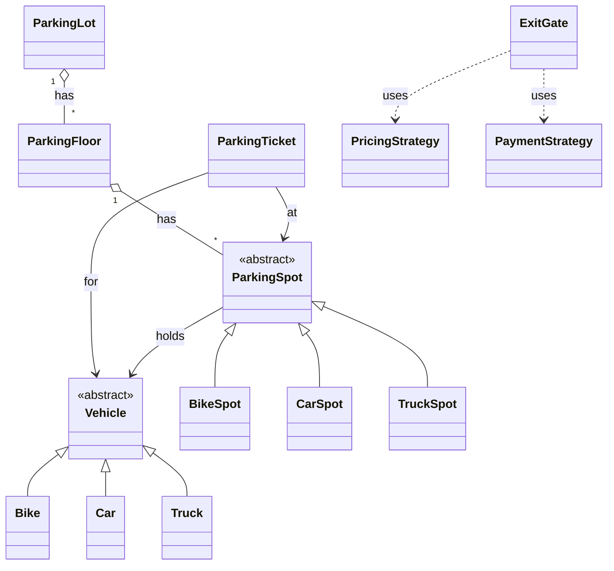
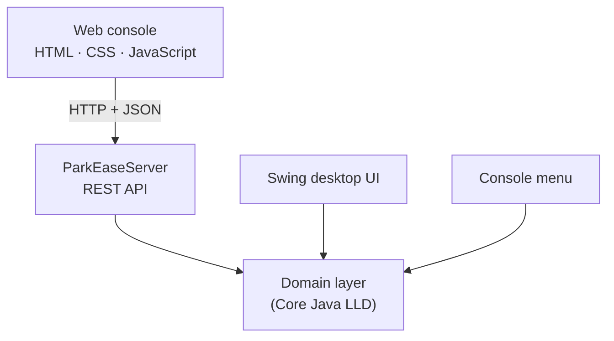

# ParkEase – Project Information
### Smart Multi-Level Parking System

**Technology:** Core Java · REST API · HTML / CSS / JavaScript · Docker
**Domain:** System Design · Low-Level Design (LLD) · Object-Oriented Programming · Design Patterns

🚀 **[Live demo → parkease-parking-system-5c45.onrender.com](https://parkease-parking-system-5c45.onrender.com)**

---

## 1. The problem

A multi-level parking facility looks simple from the outside: a car drives in, parks, and leaves. Inside, the system has to answer several questions every time:

- Which **type** of vehicle is this, and which **type** of bay can hold it?
- Which bay, on which **level**, should it get?
- How do we **record** the visit so the vehicle can be found and billed later?
- How much does the stay **cost**, and how is it **paid**?
- How do the **display boards** on every level stay accurate the moment a bay changes?

ParkEase answers these questions with a clean object-oriented design, then exposes that design through a live web application.

---

## 2. Goals

| Goal | What it means in ParkEase |
|------|---------------------------|
| **Correct** | No bay is given to two vehicles; a vehicle cannot be parked twice; charges follow the active pricing rules |
| **Modular** | Every class has one clear job: gates, floors, spots, tickets, pricing and payment are separate |
| **Extensible** | New pricing, payment or allocation rules can be added without editing the parking lot |
| **Reusable** | One Java core powers a web app, a desktop app and a console app without modification |

---

## 3. Core features

### 🅿️ Parking lot management
One parking lot with multiple **levels**, each holding **Bike**, **Car** and **Truck** bays, plus entry and exit gates. The lot keeps the central registry of active tickets, while each level manages its own bays.

### 🚗 Vehicle types
`Bike`, `Car` and `Truck` share a common `Vehicle` abstraction. Code that works with "a vehicle" never needs to know which kind it is.

### 🧱 Bay types
`BikeSpot`, `CarSpot` and `TruckSpot` each decide for themselves which vehicles they accept through `canFitVehicle()`, so the matching rule lives with the bay, not in a long `if-else` chain.

### ➡️ Entry flow
1. Reject the vehicle if it is already parked
2. Ask the active **parking strategy** for a suitable bay
3. Occupy the bay on its level, which notifies that level's display boards
4. The **entry gate** issues a ticket
5. Register the ticket by ticket number and by vehicle number for instant lookup

### 🎫 Parking ticket
Each ticket records the ticket number, vehicle, level, bay, entry time, exit time and status (`ACTIVE` / `CLOSED`). It is the object that links a vehicle's entry to its exit.

### ⬅️ Exit flow
1. Find the active ticket
2. Close it and record the exit time
3. Work out the hours parked (rounded up, minimum one hour)
4. Price the stay with the active **pricing strategy**
5. Collect payment with the chosen **payment strategy** (Cash, UPI or Card)
6. Release the bay and update the display boards

### 🔍 Locate and monitor
Find any parked vehicle by number, and watch live availability per level and vehicle type.

---

## 4. System design approach

The design was built step by step rather than as a collection of unrelated classes:

**Entities → Responsibilities → Relationships → Abstractions → Patterns → Implementation**

| Step | What was done in ParkEase |
|------|---------------------------|
| **1. Requirements** | Park, exit, bill, pay, search and display availability across multiple levels and vehicle types |
| **2. Entities** | `Vehicle`, `ParkingLot`, `ParkingFloor`, `ParkingSpot`, `ParkingTicket`, `EntryGate`, `ExitGate` |
| **3. Responsibilities** | Gates handle entry and exit, floors manage bays, spots manage occupancy, tickets record visits |
| **4. Relationships** | IS-A, HAS-A, association, aggregation and composition (see section 6) |
| **5. Class diagram** | The structure was modelled before the business logic was written |
| **6. What changes?** | Allocation rules, pricing rules and payment methods were identified as the parts most likely to change |
| **7. Abstractions** | Those parts were placed behind interfaces: `ParkingStrategy`, `PricingStrategy`, `PaymentStrategy` |
| **8. Patterns** | Factory, Strategy, Observer and Singleton applied where each solves a real problem |
| **9. Implementation** | The entry and exit workflows built on top of the design |
| **10. Extensibility check** | New strategies and new user interfaces added without changing the core |

---

## 5. Object-oriented design

| Principle | Where you can see it in ParkEase |
|-----------|----------------------------------|
| **Encapsulation** | A `ParkingSpot` keeps its occupied state private. The only way to change it is `parkVehicle()` or `removeVehicle()`, which refuse to double-park or empty an empty bay |
| **Abstraction** | `Vehicle` and `ParkingSpot` are abstract classes; callers ask a spot *"can you fit this vehicle?"* without knowing the rule inside |
| **Inheritance** | `Bike`, `Car`, `Truck` extend `Vehicle`; `BikeSpot`, `CarSpot`, `TruckSpot` extend `ParkingSpot`, so shared state and behaviour are written once |
| **Polymorphism** | `canFitVehicle()` and `display()` are overridden per subclass, and `NormalPricingStrategy` / `WeekendPricingStrategy` are used interchangeably through one interface at runtime |

### Core Java features used
- **Interfaces** for every behaviour that can vary
- **Enums** (`VehicleType`, `SpotType`, `TicketStatus`) for type-safe constants
- **Collections Framework**: `HashMap` for O(1) lookup by ticket number and by vehicle number, `ArrayList` for floors, bays and observers
- **Exception handling** for business rules such as *Parking is full* and *already parked*
- **Java Time API** (`LocalDateTime`, `Duration`) for entry and exit times and billing
- **Static members** for the ticket counter, and a **`synchronized`** Singleton accessor

---

## 6. Class relationships

| Relationship | Meaning | Example in ParkEase |
|--------------|---------|---------------------|
| **IS-A** (inheritance / implementation) | A specialised kind of something | `Car` IS-A `Vehicle`; `CarSpot` IS-A `ParkingSpot`; `UPIPayment` IS-A `PaymentStrategy` |
| **HAS-A** | One object holds or uses another | `ParkingLot` HAS-A list of `ParkingFloor`s; `ParkingFloor` HAS-A list of `ParkingSpot`s |
| **Association** | Independent objects that work together | A `ParkingTicket` refers to a `Vehicle`, a `ParkingFloor` and a `ParkingSpot` |
| **Aggregation** | A whole that groups parts which exist independently | Floors and bays are created first, then added to the lot and the floor |
| **Composition** | Parts whose life is owned by the whole | The `ParkingLot` creates and owns its ticket registries; they exist only inside it |
| **Dependency** | One class temporarily uses another | `ExitGate` uses a `PricingStrategy` and a `PaymentStrategy` only while processing an exit |

---

## 7. Design patterns

| Pattern | Problem it solves | ParkEase implementation |
|---------|-------------------|-------------------------|
| **Factory** | Object creation scattered across the code | `VehicleFactory` creates the right `Vehicle` from a `VehicleType` |
| **Strategy** | Rules that change (allocation, pricing, payment) hard-coded into the lot | `ParkingStrategy`, `PricingStrategy`, `PaymentStrategy`, swappable at runtime |
| **Observer** | Display boards that must refresh whenever a bay changes | `ParkingFloor` notifies every registered `ParkingObserver`: display boards, the web activity feed and the desktop UI |
| **Singleton** | Exactly one authority over all floors and tickets | `ParkingLot.getInstance()` |

---

## 8. SOLID principles

| Principle | In ParkEase |
|-----------|-------------|
| **S**ingle Responsibility | Entry, exit, pricing, payment, tickets and bays each live in their own class |
| **O**pen/Closed | A new pricing, payment or allocation strategy is a new class; `ParkingLot` does not change |
| **L**iskov Substitution | Any `ParkingSpot` subtype can be used wherever a `ParkingSpot` is expected |
| **I**nterface Segregation | Small, focused interfaces, each with a single method |
| **D**ependency Inversion | `ParkingLot` and `ExitGate` depend on strategy interfaces, not concrete classes |

---

## 9. Beyond the core: from LLD to a live product

The same domain classes are used, unchanged, by three interfaces:

- **REST API** built on the JDK's built-in HTTP server, with no frameworks
- **Premium web console** with a live bay map, ticket and receipt views, and an activity feed
- **Thread safety:** the domain classes are not thread-safe, so the server handles one request at a time
- **Security:** input validation, request size limits, path-traversal protection and security headers
- **Deployment:** Docker multi-stage build, running as a non-root user on Render
- **Testing:** automated Playwright checks at 6 screen sizes, plus a full park → exit flow

---

## 10. Known limitations and next steps

Being clear about trade-offs is part of good design:

| Current limitation | Planned improvement |
|--------------------|---------------------|
| Data is held in memory and resets on restart | Database persistence (e.g. MySQL or SQLite with JDBC) behind a Repository layer |
| The lot finds a bay's floor by searching the floors again | Let each bay know its floor, so any allocation strategy works safely |
| Requests are processed one at a time | Fine-grained locking or concurrent collections for multiple gates |
| Pricing is applied at exit | Lock the rate onto the ticket at entry |
| One shared demo lot | User accounts, authentication and per-user sessions |

---

## Acknowledgement

The project brief and the Low-Level Design foundation come from the **Logic Building** programme at **Marvellous Infosystems**. ParkEase extends that foundation into a deployed product with a REST API, a web console, a desktop UI, Docker deployment and automated testing.

---

**© 2026 Madhura Ajay Pande. All rights reserved.**

[Live demo](https://parkease-parking-system-5c45.onrender.com) · [LinkedIn](https://www.linkedin.com/in/madhura-pande-363930325) · madhurapande18@gmail.com

