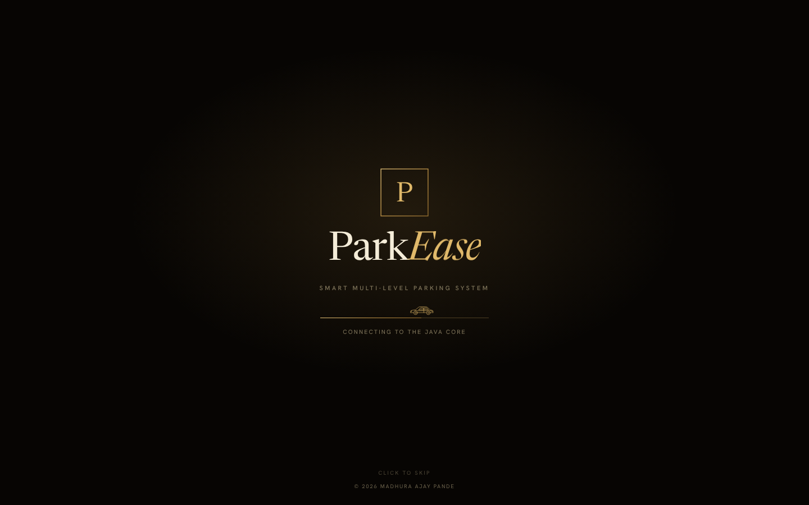
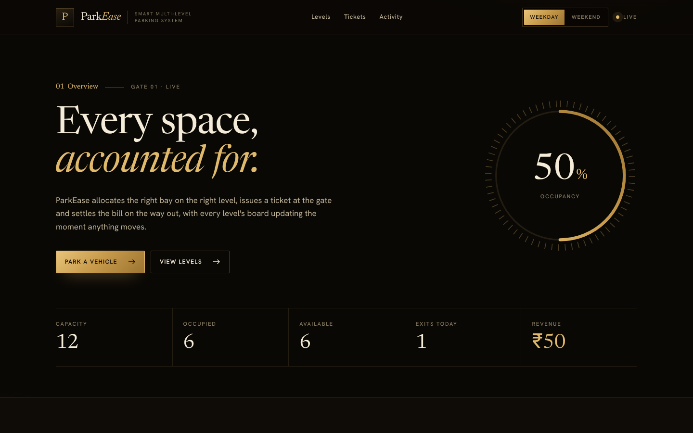
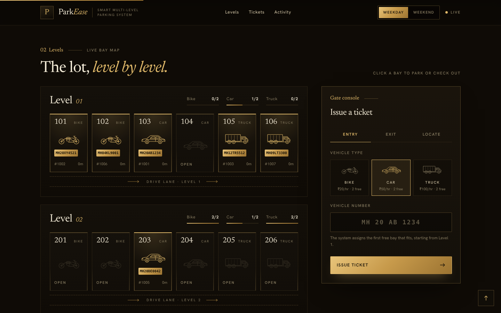
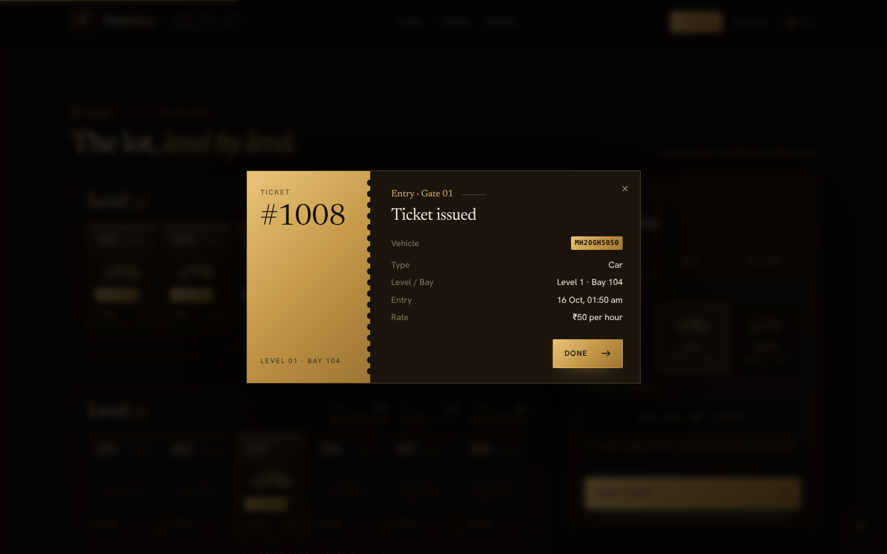
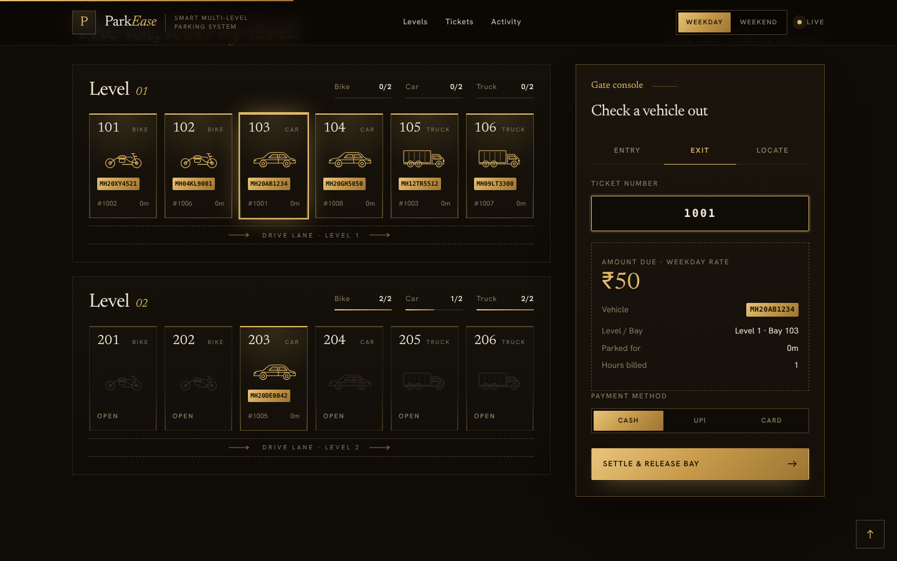
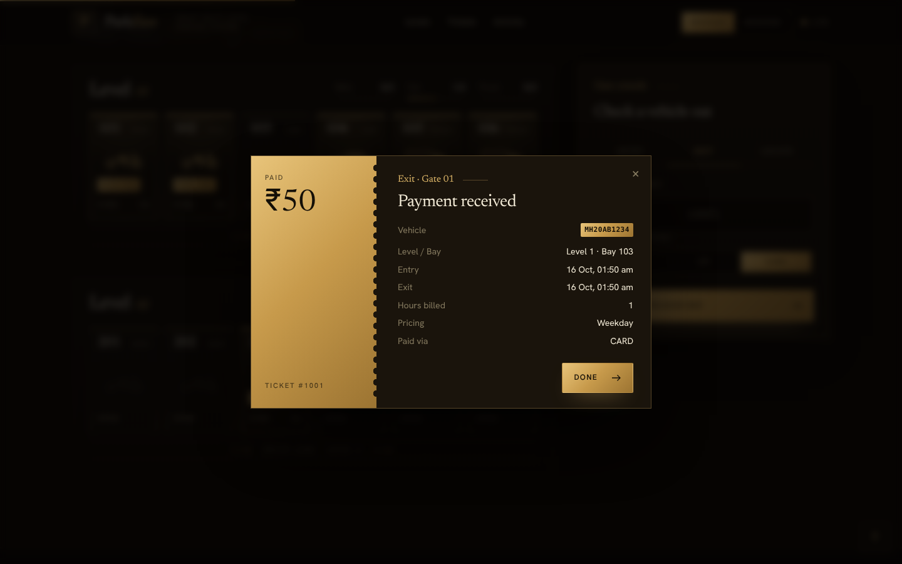
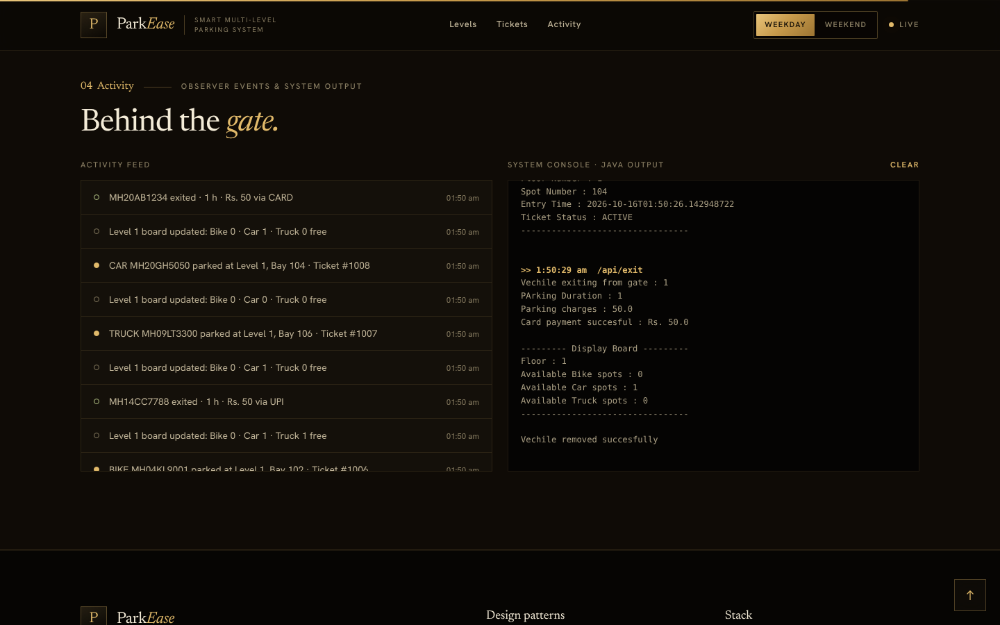
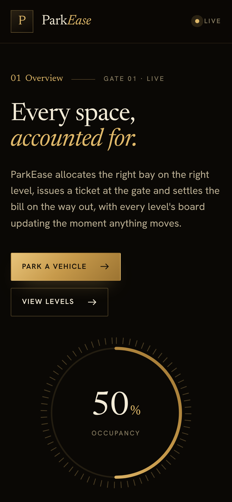
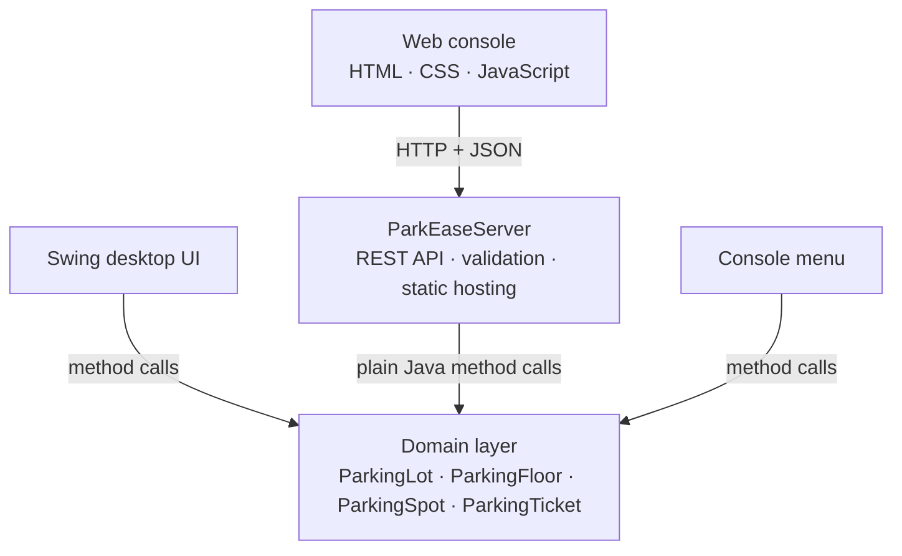
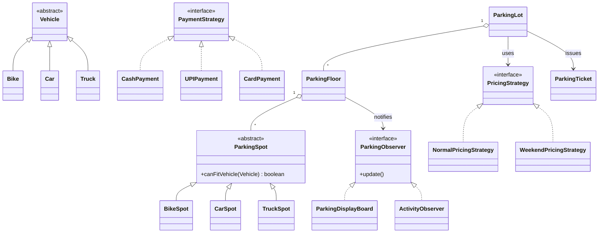

# ParkEase
### Smart Multi-Level Parking System

**A Java low-level design core, exposed through a REST API and driven by a premium web console.**

---

## Live demo

**▶ [parkease-parking-system-5c45.onrender.com](https://parkease-parking-system-5c45.onrender.com)**

Park a vehicle, check it out, switch pricing and watch the live bay map update. No sign-up needed.

> Hosted on a free plan: if nobody has visited for 15 minutes, the first load takes about a minute while the server wakes up. Demo data is shared by all visitors and resets on restart.

---

## Overview

ParkEase models a real multi-level parking facility. Vehicles enter at a gate, are assigned the first bay that fits, receive a ticket, and are billed and released on exit. Every level has a display board that updates the moment a bay is taken or freed.

The project is built in layers. The parking logic is a self-contained **Java object-oriented design**, and the user interfaces sit on top of it without changing it:

- a **web console** (HTML, CSS, JavaScript), served by a lightweight **Java REST API**
- a **Swing desktop app**
- the original **console menu**

---

## Screenshots

<table>
  <tr>
    <td width="50%"> <b>Overview:</b> live occupancy, capacity and revenue</td>
    <td width="50%"> <b>Live bay map:</b> every bay on every level, with the gate console</td>
  </tr>
  <tr>
    <td> <b>Entry:</b> ticket issued with level, bay and hourly rate</td>
    <td> <b>Exit:</b> live charge quote before payment</td>
  </tr>
  <tr>
    <td> <b>Receipt:</b> billed hours, pricing strategy and payment method</td>
    <td> <b>Behind the gate:</b> observer events and live Java output</td>
  </tr>
</table>

 Fully responsive, tested from 360 px to 1920 px

---

## Features

| Area | What it does |
|------|--------------|
| **Allocation** | Assigns the first free bay that fits the vehicle type, across two levels (Bike, Car and Truck bays) |
| **Entry** | Issues a ticket with a unique number, level, bay and entry time; rejects duplicate vehicles |
| **Exit & billing** | Live charge quote, hours rounded up, payment by Cash, UPI or Card |
| **Pricing** | Weekday and Weekend rates, switchable at runtime |
| **Locate** | Finds any parked vehicle and highlights its bay on the map |
| **Live boards** | Each level's availability updates instantly when a bay changes |
| **Activity** | Feed of every event, plus the raw output printed by the Java domain classes |

---

## Architecture

The domain layer knows nothing about HTTP, Swing or the browser. Each interface is a thin adapter around the same core, so a new interface can be added without changing the parking logic.

---

## Design patterns

| Pattern | Where it is used | Why |
|---------|------------------|-----|
| **Factory** | `VehicleFactory` creates Bike, Car and Truck objects | Centralises object creation; callers depend only on `Vehicle` |
| **Strategy** | `ParkingStrategy`, `PricingStrategy`, `PaymentStrategy` | Allocation, pricing and payment rules can change at runtime without touching the lot |
| **Observer** | `ParkingFloor` notifies display boards and the web activity feed | Any number of displays stay in sync; adding one needs no change to the floor |
| **Singleton** | `ParkingLot.getInstance()` | Exactly one parking lot controls every floor and ticket |

---

## REST API

| Method | Endpoint | Purpose |
|--------|----------|---------|
| `GET`  | `/api/state`   | Snapshot of levels, bays, tickets, rates and statistics |
| `POST` | `/api/park`    | Park a vehicle and issue a ticket |
| `GET`  | `/api/quote`   | Current charge for an active ticket |
| `POST` | `/api/exit`    | Bill, take payment and release the bay |
| `GET`  | `/api/search`  | Locate a parked vehicle |
| `POST` | `/api/pricing` | Switch between weekday and weekend pricing |

Errors return JSON with a clear message: `400` for invalid input, `409` for business rules such as *Parking is full*.

---

## Engineering highlights

- **Clean layering:** the REST server and both UIs reuse the domain classes unchanged.
- **Thread safety by design:** the domain uses non-thread-safe collections, so the server processes one request at a time and the core never sees concurrent calls.
- **Single source of truth:** hourly rates shown in the UI are computed by the active `PricingStrategy`, never duplicated in JavaScript.
- **Security:** input validation on every field, an 8 KB request limit, path-traversal protection, security headers, and a non-root Docker container.
- **No framework, no dependencies:** the server uses only the JDK's built-in HTTP server.
- **Automated UI tests:** Playwright checks 6 screen sizes for overflow, JavaScript errors and failed requests, then runs a full park → exit flow.
- **Accessibility and motion:** labelled controls, keyboard-friendly dialogs, and all animation disabled under `prefers-reduced-motion`.

---

## Tech stack

| Layer | Technology |
|-------|------------|
| Domain | Java 21 (OOP, design patterns, collections, `java.time`) |
| API | JDK `HttpServer`, REST, JSON |
| Web | HTML5, CSS3 (custom properties, `clamp()`, grid), vanilla JavaScript |
| Desktop | Java Swing |
| Deployment | Docker (multi-stage build), Render |
| Testing | Playwright (Python) |

---

## Source code

The source code is kept in a **private repository**. It is available for review on request, for example during an interview.

📧 **madhurapande18@gmail.com**  ·  💼 [LinkedIn](https://www.linkedin.com/in/madhura-pande-363930325)  ·  🐙 [GitHub](https://github.com/MadhuraPande18)

---

**© 2026 Madhura Ajay Pande. All rights reserved.**

ParkEase is proprietary. The screenshots and documentation in this repository may not be copied, modified or redistributed without written permission. See [LICENSE](LICENSE).

